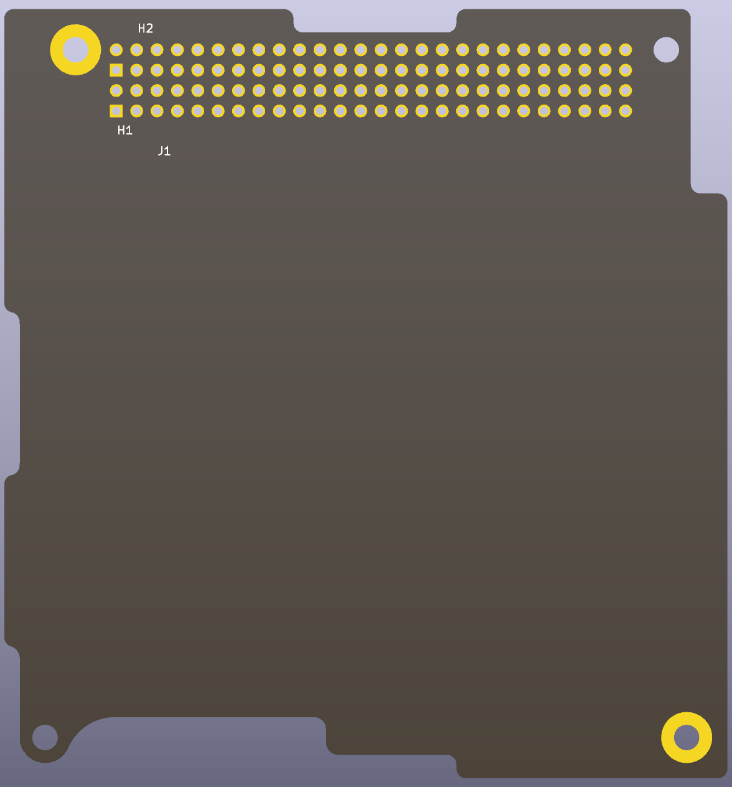
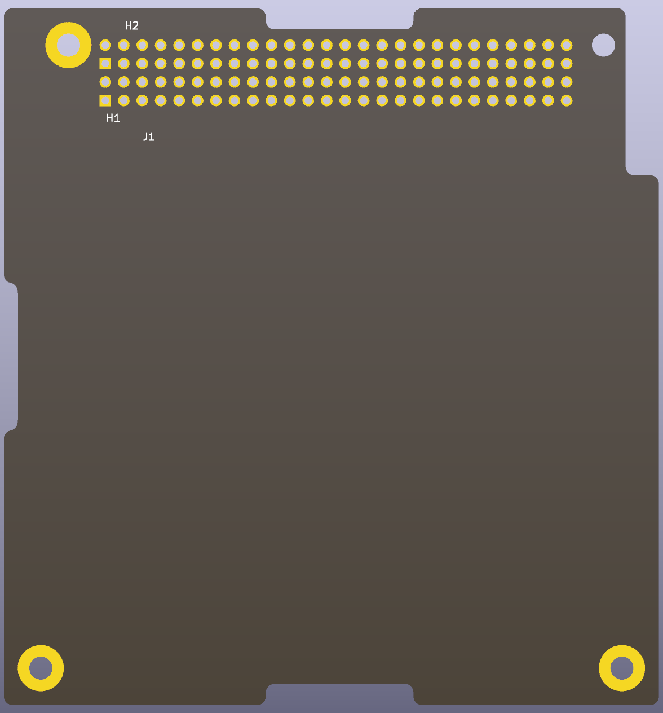

# cubesat-pc104-kicad

KiCad parts and boards for CubeSat Kit modules on the PC/104 form factor: two
2×26 stack headers (H1 and H2) and four mounting holes.

**Documentation: <https://cameronbrooks11.github.io/cubesat-pc104-kicad/>**

  
  

The footprints are generated from, and checked against, Pumpkin's *CubeSat Kit
PCB Specification* (810-00253 rev B2), and the symbols name every pin by its
CubeSat Kit bus signal. Two project templates and a worked 4-layer example
board are built from the library. Everything needs KiCad 10 and is tested with
10.0.6.

## Get it

Each [release](https://github.com/CameronBrooks11/cubesat-pc104-kicad/releases)
carries:

| Asset | Contents |
| --- | --- |
| `CubeSat_PC104-<version>.zip` | The symbol and footprint library, to add to any project |
| `cubesat-pc104-templates-<version>.zip` | Both project templates |
| `CSK_Bus_Breakout-<version>.zip` | The breakout board's KiCad project |
| `CSK_Bus_Breakout-fab-<version>.zip` | The breakout's Gerbers and drill files, ready to order |

- **New module:** [start from a template](https://cameronbrooks11.github.io/cubesat-pc104-kicad/getting-started/#start-a-module-from-a-template).
- **Existing board:** [add the library to a project](https://cameronbrooks11.github.io/cubesat-pc104-kicad/getting-started/#add-the-library-to-an-existing-project).
- **What each bus pin carries:** [bus pinout](https://cameronbrooks11.github.io/cubesat-pc104-kicad/pinout/).

Changes are listed in [CHANGELOG.md](CHANGELOG.md).

## Layout

| Folder | What it holds |
| --- | --- |
| [`library/`](library/) | The `CubeSat_PC104` symbol and footprint library. This is the source; edit it here. |
| [`templates/`](templates/) | Two project templates, one per board pattern. |
| [`breakout/`](breakout/) | A finished example board, the bus breakout. |
| [`tools/`](tools/) | The generators that write the library and the breakout, and the pin tables they read. |
| [`docs/`](docs/) | The documentation site. |

Each template and `breakout/` carries its own copy of the library, because
KiCad copies a template folder as it is and the breakout ships as its own zip:
a project that pointed back at `library/` would lose its parts once copied.
`just sync-template` writes the copies and `just check` fails if one differs.

The library is named for the form factor (`CubeSat_PC104`); its parts are named
for the CubeSat Kit specification they follow (`CSK_`).

## Development

With [just](https://just.systems/), Python 3 and KiCad 10's `kicad-cli`,
`just check` is the gate CI runs on every pull request. The
[development page](https://cameronbrooks11.github.io/cubesat-pc104-kicad/development/)
covers the generators, changing a part, releases and building the docs.

## Credits

The SUCHAI payload pinout is from SPEL at the Universidad de Chile,
[spel-uchile/Payload-PC104](https://github.com/spel-uchile/Payload-PC104)
(matvidal, EliasObreque and Alex Becerra, 2018 to 2022). This repository began
as a KiCad import of their Eagle stack breakout; that board and the Eagle
files were removed when the library, templates and breakout were redone, and
remain in this repository's history under SPEL's GPL-3.0.

The CubeSat Kit is Pumpkin, Inc.'s. PC/104 is a standard of the
[RMS Consortium](https://www.rmsconsortium.org/), formerly the PC/104
Consortium. This project is not affiliated with either.

## License

[CERN-OHL-P-2.0](./LICENSE): a permissive open-hardware licence. You can use
the library, templates and breakout in your own boards, open or closed, and
modify them, without sharing your design. Keep the licence notice with any copy
of these files. The source is
<https://github.com/CameronBrooks11/cubesat-pc104-kicad>.

Commits before the relicensing carried SPEL's GPL-3.0 and remain under it.
