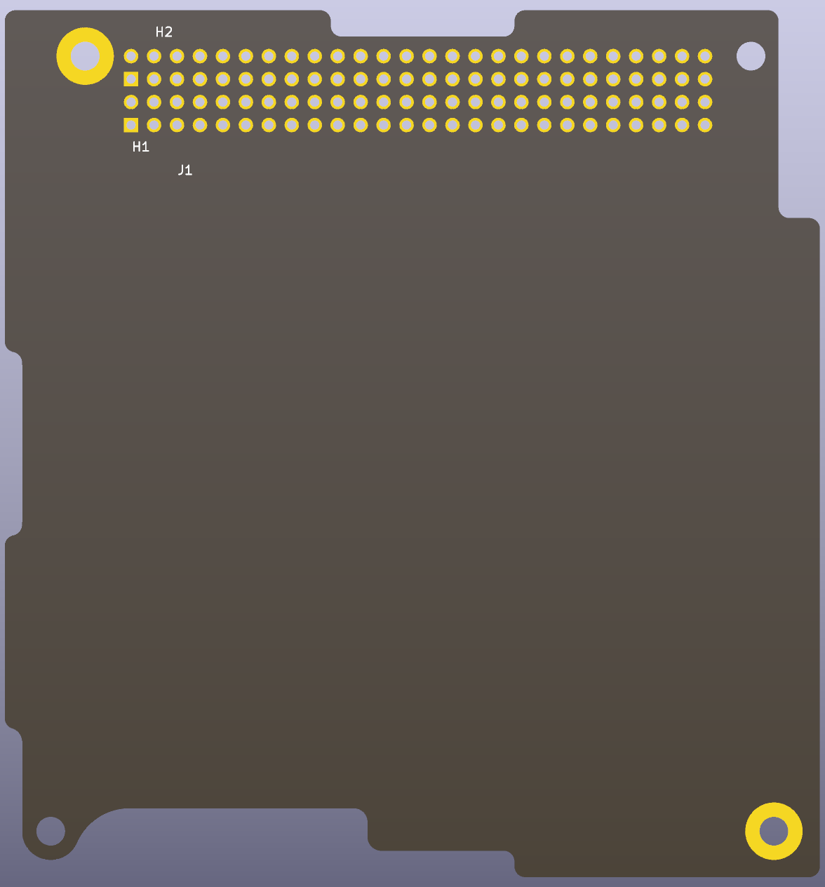
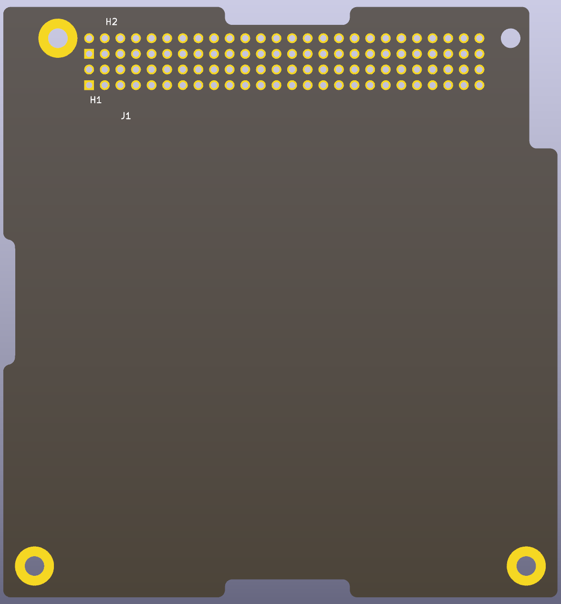
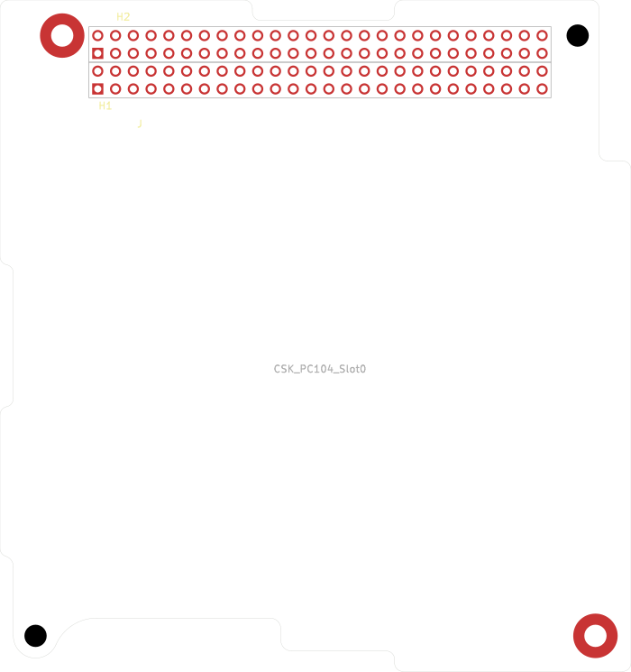
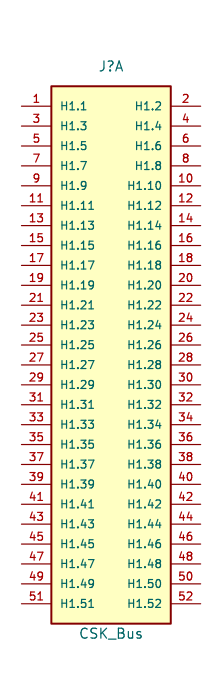
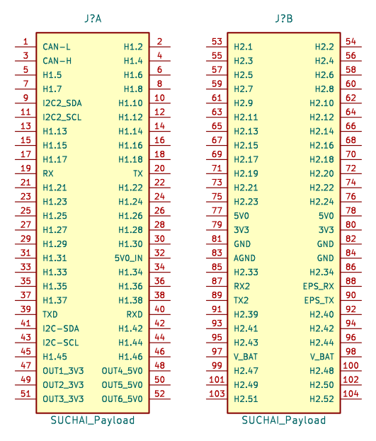
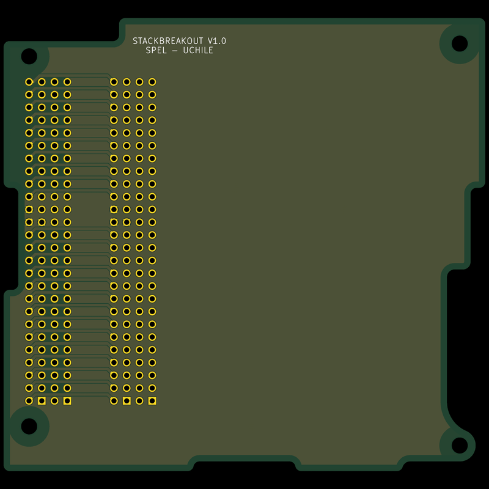
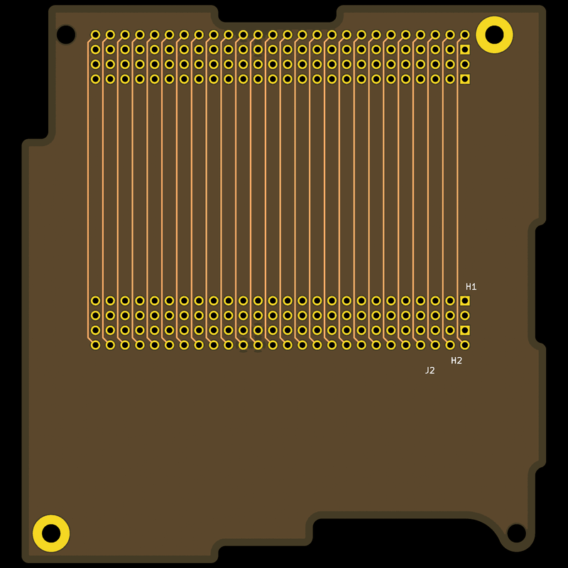

# cubesat-pc104-kicad

KiCad parts and boards for CubeSat Kit modules on the PC/104 form factor: two
2×26 stack headers (H1 and H2) and four mounting holes.

The library, the project templates and the stack breakout board's outline are
checked against the CubeSat Kit specification.

## Project templates

KiCad 10 project templates for a CubeSat Kit user module: the board outline, the
H1/H2 bus as connector J1 and the mounting holes, with copper kept 1.27 mm from
the edge. Each passes DRC with schematic parity; ERC lists the 104 bus pins as
unconnected until you wire them or flag them.

| Template | Pattern |
| --- | --- |
| [`templates/CubeSat_PC104_Slot0`](templates/CubeSat_PC104_Slot0/) | Base "Slot 0": the separation switch cutouts and keepouts. Pumpkin's example stack uses this pattern at both positions, so it is the default choice. |
| [`templates/CubeSat_PC104_Slot1`](templates/CubeSat_PC104_Slot1/) | Extended "Slot 1": the same holes and headers with a fuller bottom-left corner and no keepouts. |

  
  

1. Clone this repository, or copy a template directory out of it.
2. In KiCad choose **File → New Project from Template**, open the user
   templates tab and point it at `templates/`.
3. Pick the template and name the project. KiCad copies the files and renames
   them after the project.
4. In the schematic, wire the bus pins the module uses and put a no-connect
   flag on the others.

Each template carries its own copy of the `CubeSat_PC104` library, so a new
project needs nothing else installed.

## Stack connectors

The footprints are pads only, so either way of mounting the bus connectors fits
them; choose the parts and the side to suit the stack.

- **CubeSat Kit convention.** Each module has its sockets on the top side. A
  module that plugs onto another uses a long-tail part whose tails pass through
  the board into the sockets below: ESQ-126-39-G-D (extended tail) in Pumpkin's
  example stacks. The specification's Slot 0 sheet lists ESQ-126-37-G-D, a
  non-stack-through part. The specification gives two board spacings,
  15.24 mm to 17.00 mm, or 24.00 mm to 26.00 mm with an extra Samtec
  SSQ-126-22-G-D to span the gap, and recommends components no taller than
  13.0 mm (15.24 mm spacing) or 21.5 mm (24 mm spacing) on the top side and
  3.8 mm on the bottom.
- **Socket on the bottom.** SPEL's stack breakout mounts Samtec SSQ-126-23-G-D
  sockets on the bottom side; with their 10.00 mm tails, the pins stand up
  through the top. That suits a stack whose boards present pins upward, and does
  not plug into the top of a CubeSat Kit stack, whose modules present sockets.

## Library

`KiCad/CubeSat_PC104.kicad_sym` and `KiCad/CubeSat_PC104.pretty/`. Add them to
a project as the symbol and footprint libraries `CubeSat_PC104`.

| Part | What it is |
| --- | --- |
| `CSK_PC104_Slot0` (footprint) | A CubeSat Kit user module in the base "Slot 0" pattern: board outline, H1 and H2 headers, mounting holes, and keepout areas. Origin at H1 pin 1. |
| `CSK_PC104_Slot1` (footprint) | The same in the extended "Slot 1" pattern, without the 2nd switch cutout or keepouts. |
| `CSK_Bus` (symbol) | The bus headers for any payload: unit A is H1 (pins 1–52), unit B is H2 (pins 53–104), all passive. |
| `SUCHAI_Payload` (symbol) | The SUCHAI 2 and 3 payload pinout on the same two units, with supply pins as power inputs. Unused pins are named as on `CSK_Bus`. |

`tools/gensym.py` generates the symbol library; the SUCHAI pinout is the table
in `tools/suchai_pins.csv`.

### Against the specification

The footprints follow Pumpkin's *CubeSat Kit PCB Specification*, drawing
810-00253, revision B2 (2018-11-08). Each was generated from the drawing's DXF
for its slot; the holes and all 104 pins land on the DXF's to within 0.0001 mm.
Where Slot 0 departs from the drawing:

- **Bottom-left edge.** The DXF leaves the outline open at the bottom-left hole,
  where the drawing calls for the feature that lets the 2nd separation switch
  work. It is closed along that hole's 6.35 mm pad circle.
- **Two holes without pads.** The drawing gives each hole a 6.35 mm pad and also
  recommends keeping copper 1.27 mm from the edge. At the bottom-left and
  top-right holes the edge is 3.175 mm and 3.048 mm from the hole centre, so
  both can't hold. Those two are bare 3.18 mm holes; the other two have plated
  6.35 mm pads.
- **Keepouts.** The three boxes in the DXF are rule areas that allow no
  footprints: the "no parts placed here" patch on the right edge (top side) and
  the clearances for separation switches 1 and 2 (both sides). The bottom-side
  strips where the board rests on the structure's flange are hatched in the
  drawing but not dimensioned, so they are not included.
- **Edge setback.** The drawing recommends 1.27 mm from the edge for all copper.
  That is a board setting (copper to edge clearance), not part of the footprint.

Slot 1's outline is closed in its DXF and it has no keepout boxes. Its top-right
hole is bare for the same reason as Slot 0's; the other three have plated
6.35 mm pads.

The specification documents are not in this repository.

## Stack breakout board

`PC104/` is the 4-layer stack breakout board, imported from the Eagle design in
`Eagle/`. It carries every bus pin from the stack headers to a second pair of
headers 16.9 mm over. It has the CubeSat Kit Slot 0 outline and keepouts, with
copper kept 1.27 mm from the edge, and a generic 1.6 mm 4-layer stackup (35 µm
copper, FR4). In KiCad 10.0.6, ERC is clean and DRC reports 0 violations,
0 unconnected items and 0 schematic parity issues, with the ground pours filled.

  
  

## Development

With [just](https://just.systems/) and KiCad 10's `kicad-cli`:

- `just check` confirms each template's library copy matches `KiCad/` and runs
  DRC with schematic parity on each template board. CI runs it in the official
  `kicad/kicad:10.0.6` image on every pull request and push to `main`.
- `just sync-template` copies the library into every template after a change.
- `just fab` plots the stack breakout board's Gerbers and drill files into
  `fab/` and zips them, and refuses if DRC finds anything. For another board,
  `just fab board=templates/CubeSat_PC104_Slot0/CubeSat_PC104_Slot0.kicad_pcb copper=F.Cu,B.Cu`.

## Credits

The SUCHAI pinout, the Eagle designs and the stack breakout board are by SPEL at
the Universidad de Chile, from
[spel-uchile/Payload-PC104](https://github.com/spel-uchile/Payload-PC104)
(matvidal, EliasObreque and Alex Becerra, 2018 to 2022). Its history is kept in
this repository; the KiCad import of the stack breakout board is from 2024.

The CubeSat Kit is Pumpkin, Inc.'s. PC/104 is a standard of the
[RMS Consortium](https://www.rmsconsortium.org/), formerly the PC/104
Consortium. This project is not affiliated with either.

## License

GPL-3.0, as published by SPEL. See [LICENSE](./LICENSE).
